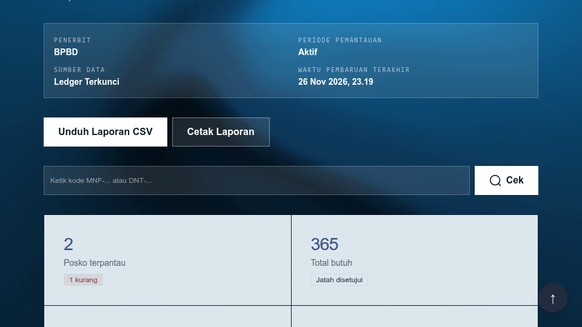
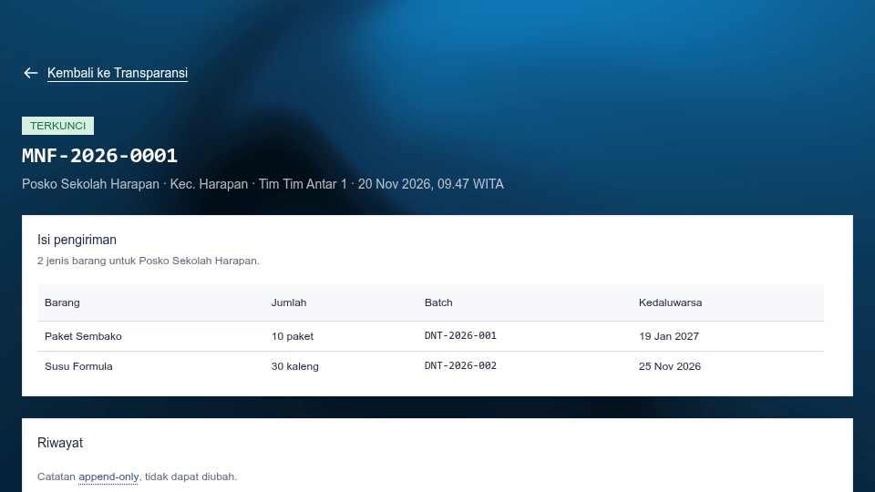
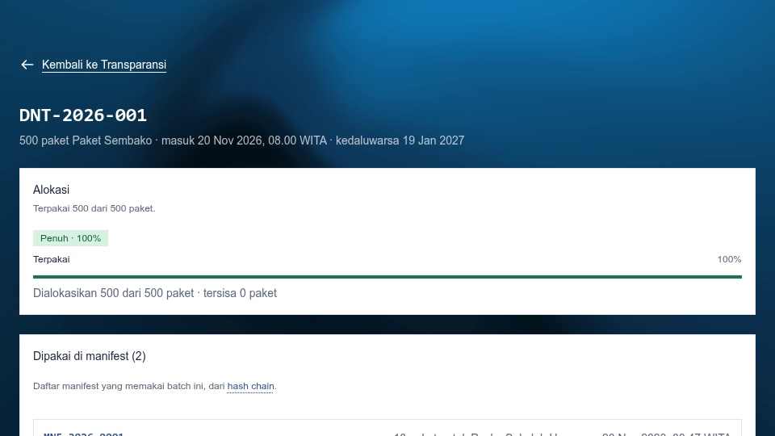
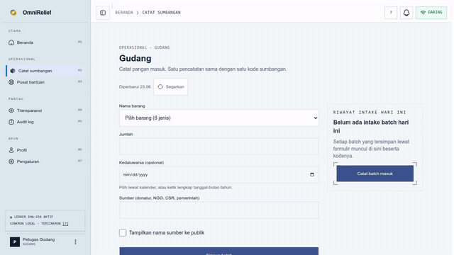
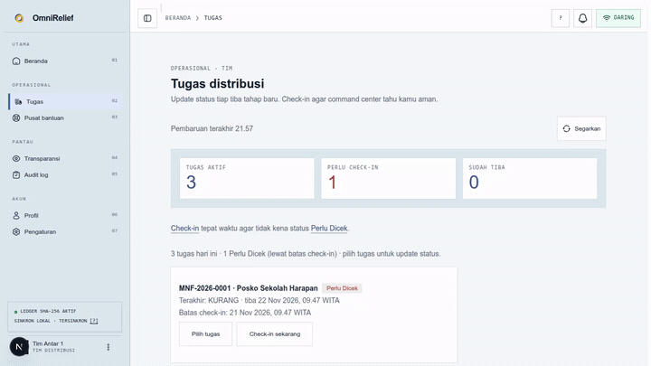

<p align="center">
  
</p>

<h1 align="center">OmniRelief</h1>

<p align="center">Sistem pencatatan dan pelacakan distribusi pangan darurat yang menghubungkan gudang, BPBD, tim pengantar, posko, dan publik dalam satu rantai data terkunci.</p>

<p align="center">
  
  
  
  
  
  
</p>

<p align="center">
  <a href="docs/JURI.md">Panduan Juri</a> ·
  <a href="docs/SISTEM-DAN-FITUR.md">Sistem &amp; Fitur</a> ·
  <a href="docs/DESIGN-SYSTEM.md">Design System &amp; Logo</a> ·
  <a href="docs/SETUP.md">Panduan Instalasi</a> ·
  <a href="ROADMAP.md">Peta Produk</a> ·
  <a href="CHANGELOG.md">Perubahan</a> ·
  <a href="CONTRIBUTING.md">Kontribusi</a> ·
  <a href="GLOSSARY.md">Glosarium</a>
</p>

## Masalah nyata yang diselesaikan

Saat bencana terjadi, kelaparan sering muncul karena rantai pasok pangan terputus dan pencatatannya tidak transparan. Bantuan menumpuk di satu posko sementara posko lain masih kekurangan, stok pangan kedaluwarsa di gudang karena tidak diprioritaskan keluar lebih dulu, dan kiriman di lapangan kehilangan kabar tanpa kejelasan status.

Akibatnya, posko kesulitan membuktikan bahwa jatah mereka belum terpenuhi, sedangkan donatur berhenti menyumbang karena tidak pernah tahu apakah bantuannya benar-benar sampai ke penerima. OmniRelief menjawab persoalan ini dalam sub-tema Zero Hunger (SEVENT X Software Development) dengan mencatat setiap perpindahan pangan secara terpisah per posko dan membukanya untuk pemeriksaan publik tanpa perlu login.

## Bagaimana OmniRelief bekerja

1. **Gudang menerima sumbangan dan menerbitkan kode pelacakan.** Petugas gudang mencatat jenis barang, jumlah, tanggal kedaluwarsa, dan sumber sumbangan. Sistem langsung menghasilkan kode unik `DNT-TAHUN-NOMOR` agar donatur dapat melacak alokasi bantuannya.
2. **Posko melaporkan jumlah penyintas.** Setiap posko mengirimkan snapshot penyintas untuk satu periode secara terpisah. Data antar posko tidak pernah digabung agar kekurangan di satu titik tidak tertutup oleh kelebihan di titik lain.
3. **BPBD memverifikasi kebutuhan dan menyusun manifest.** BPBD meninjau snapshot penyintas dengan keputusan disetujui, minta revisi, atau ditolak. Untuk laporan yang disetujui, BPBD menyusun draf manifest dengan prioritas batch yang paling dekat tanggal kedaluwarsanya (aturan FEFO).
4. **Publikasi mengunci data secara permanen.** Begitu manifest dipublikasikan, sistem menerbitkan kode `MNF-TAHUN-NOMOR`, membuat kode QR, dan mengunci dokumen tersebut. Manifest yang sudah terpublikasi tidak memiliki tombol edit maupun hapus.
5. **Tim mengantar meski sinyal terputus.** Tim distribusi memperbarui status kiriman dan mengirim check-in berkala dari lapangan. Jika koneksi internet mati, data disimpan sementara dengan status Menunggu Sinkronisasi dan terkirim otomatis saat sinyal kembali. Bila tim melewati batas waktu tanpa kabar, status kiriman otomatis berubah menjadi Perlu Dicek.
6. **Posko mengonfirmasi terima dan publik memverifikasi.** Posko menutup selisih kebutuhan dengan menekan konfirmasi terima, atau melaporkan ketidaksesuaian jika barang kurang atau rusak. Seluruh riwayat ini langsung tampil di halaman publik.

## Manfaat untuk setiap pengguna

1. **Donatur dan Publik** dapat memeriksa kondisi nyata setiap posko di `/transparansi`, memverifikasi isi dan riwayat kiriman di `/m/[kode]`, serta memantau sejauh mana sumbangannya sudah disalurkan melalui `/s/[kode]` tanpa login.
2. **Posko** memiliki bukti terbuka atas selisih kebutuhan pangan yang belum terpenuhi serta kanal resmi untuk melaporkan bantuan yang rusak atau kurang.
3. **Gudang** mencegah pemborosan pangan karena sistem memisahkan setiap batch berdasarkan tanggal kedaluwarsa dan mempermudah pencatatan asal sumbangan.
4. **BPBD** melihat daftar prioritas posko dengan selisih kekurangan terbesar dan langsung mendeteksi kiriman yang melewati batas waktu check-in.
5. **Tim Distribusi** tetap dapat mencatat pengantaran di area minim sinyal melalui antrean offline otomatis.

## Mengapa data di OmniRelief dapat dipercaya

1. **Riwayat hanya bertambah (append-only).** Manifest yang sudah dipublikasikan tidak dapat diubah atau dihapus lewat antarmuka maupun perintah pembaruan langsung ke database.
2. **Terikat rantai hash SHA-256.** Setiap manifest dan baris riwayat menyimpan hash SHA-256 yang terhubung ke hash baris sebelumnya. Jika satu angka saja diubah diam-diam di database, rantai hash langsung terputus dan sistem mendeteksi kejanggalan tersebut.
3. **Akses publik tanpa data pribadi.** Seluruh halaman publik hanya menampilkan angka agregat penyintas, daftar batch pangan, serta riwayat status kiriman.

## Demo visual

Cuplikan berikut memperlihatkan alur publik selama 30 detik, mulai dari mengecek kode sumbangan di halaman utama, melihat rincian alokasi batch, memeriksa dashboard transparansi per posko, hingga membuka detail manifest yang sudah terkunci.

<details>
<summary>Putar demo alur publik (GIF, 30 detik)</summary>


</details>

| Halaman utama | Dashboard transparansi |
| --- | --- |
|  |  |
| Detail manifest terkunci | Detail pelacakan sumbangan |
|  |  |

<details>
<summary>Demo peran Gudang, Posko, BPBD, dan Tim Distribusi</summary>

<p><strong>Gudang:</strong> mencatat batch masuk hingga kode sumbangan terbit dan tampil di halaman publik.</p>


<p><strong>Posko:</strong> melaporkan snapshot penyintas hingga menunggu verifikasi BPBD.</p>


<p><strong>BPBD:</strong> memverifikasi snapshot hingga memublikasikan dan mengunci manifest.</p>


<p><strong>Tim Distribusi:</strong> memilih tugas pengantaran dan mengirim check-in.</p>


</details>

## Mencoba aplikasi secara cepat

Anda dapat langsung membuka rute publik tanpa akun, atau masuk menggunakan akun demo yang tersedia pada data awal (`supabase/seed.sql`) untuk dua posko contoh (Posko Balai Desa Sari dan Posko Sekolah Harapan).

1. **Rute publik (tanpa login):** `/` (pencarian kode `MNF` dan `DNT`), `/transparansi` (status selisih per posko), `/m/[kode]` (detail manifest terkunci), dan `/s/[kode]` (pelacakan alokasi sumbangan).
2. **Akun demo peran internal (login di `/masuk`):** `bpbd@demo`, `gudang@demo`, `posko-a@demo`, `posko-b@demo`, `tim@demo`, dan `admin@demo`.

Untuk menjalankan aplikasi di lingkungan lokal, pasang Bun versi terbaru, siapkan satu project Supabase, lalu jalankan perintah berikut:

```bash
bun run setup
```

Isi konfigurasi Supabase di `apps/web/.env` sesuai contoh di `apps/web/.env.example`, terapkan skema dan data awal sesuai [docs/SETUP.md](docs/SETUP.md), lalu jalankan server pengembangan:

```bash
bun run dev
```

Aplikasi akan berjalan di `http://localhost:3001`. Langkah pengujian lengkap untuk juri tersedia di [docs/JURI.md](docs/JURI.md).

## Dokumentasi lengkap

1. [Panduan Juri](docs/JURI.md): skenario uji cepat 5 menit untuk mengevaluasi fitur publik, alur empat peran, dan uji anti-manipulasi.
2. [Dokumentasi Sistem dan Fitur](docs/SISTEM-DAN-FITUR.md): arsitektur aplikasi, aturan FEFO, mekanisme hash chain SHA-256, mode offline, dan rincian halaman.
3. [Design System, Token, dan Makna Logo](docs/DESIGN-SYSTEM.md): filosofi visual, daftar token semantik, standar aksesibilitas, serta makna simbol Cincin Cetak Ganda.
4. [Panduan Instalasi](docs/SETUP.md): langkah konfigurasi Supabase, seed data, akun demo, dan deployment Vercel.
5. [Peta Produk](ROADMAP.md): arah pengembangan pasca-lomba dari fondasi tepercaya hingga replikasi antar daerah.
6. [Catatan Perubahan](CHANGELOG.md): ringkasan rilis dan pembaruan fitur dari waktu ke waktu.
7. [Panduan Kontribusi](CONTRIBUTING.md): alur kerja sumber terbuka, aturan kode, verifikasi formal, dan format pull request untuk kontributor.
8. [Peta Codebase](docs/CODEBASE-MAP.md): peta direktori, modul inti, dan panduan lokasi perubahan untuk kontributor maupun agen AI.
9. [Glosarium](GLOSSARY.md): definisi istilah baku yang dipakai di seluruh antarmuka OmniRelief.

## Lisensi

Kode sumber OmniRelief dirilis di bawah lisensi MIT. Lihat [LICENSE](LICENSE) untuk detail lengkap.
