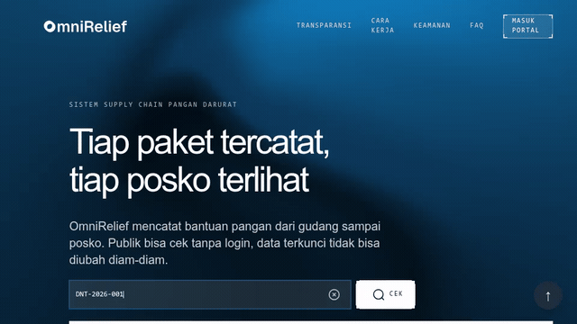
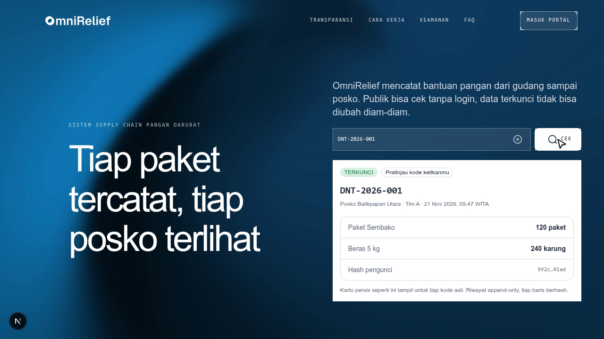
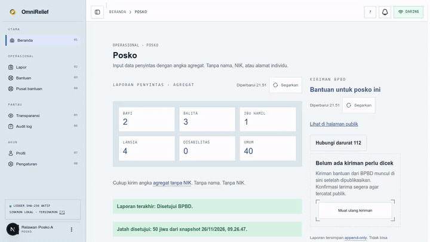
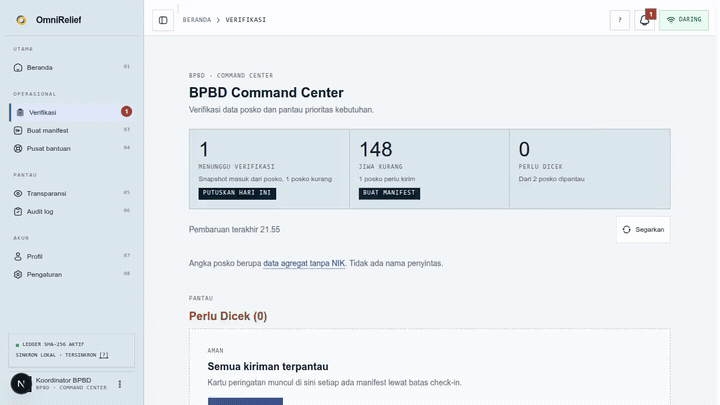

<p align="center">
  
</p>

<h1 align="center">OmniRelief</h1>

<p align="center">Sistem supply chain pangan darurat yang tercatat dari gudang sampai posko dan bisa dicek publik per daerah.</p>

<p align="center">
  
  
  
  
  
  
  
</p>

<p align="center">
  <a href="docs/OmniRelief-Dokumen-Tim-Lengkap.pdf">Dokumen tim</a> ·
  <a href="docs/JURI.md">Panduan juri</a> ·
  <a href="docs/SETUP.md">Setup</a> ·
  <a href="docs/GOALS.md">Bukti juri</a> ·
  <a href="docs/PAGES.md">Peta halaman</a> ·
  <a href="ROADMAP.md">Peta produk</a> ·
  <a href="CHANGELOG.md">Perubahan</a> ·
  <a href="CONTRIBUTING.md">Kontribusi</a> ·
  <a href="GLOSSARY.md">Istilah</a>
</p>

## Ringkasan

OmniRelief mencatat aliran pangan darurat dari gudang sampai posko. Setiap posko tercatat terpisah. Angka satu posko tidak pernah digabung dengan posko lain. Publik bisa memeriksa status tiap daerah tanpa login.

Repo ini dibuat untuk lomba SEVENT X Software Development, sub-tema Zero Hunger. Stack dikunci pada Next.js plus Supabase plus Vercel. Sumber kebenaran untuk deadline dan scope adalah `docs/OmniRelief-Dokumen-Tim-Lengkap.pdf`.

## Masalah yang dijawab

Bantuan pangan sering tercatat di banyak tempat. Donatur sulit melacak sumbangannya. Posko sulit membuktikan jatahnya kurang. Data bisa diubah diam-diam setelah dikirim.

OmniRelief menjawab dengan satu alur tercatat. Sumbangan masuk lewat gudang dan mendapat kode. Posko melapor dan BPBD memverifikasi. Manifest terkunci lalu tim mengantar. Posko mengonfirmasi terima. Semua langkah tampil di halaman publik.

## Cara kerja

1. Gudang mencatat sumbangan. Sistem memberi kode sumbangan dengan format `DNT-TAHUN-NOMOR`.
2. Posko mengirim snapshot penyintas untuk satu periode.
3. BPBD memberi putusan verifikasi. Putusan berupa disetujui, minta revisi, atau ditolak. Hanya snapshot yang disetujui yang menjadi jatah.
4. BPBD menyusun draf manifest untuk satu posko. Batch dipilih dengan aturan FEFO. Publikasi mengunci manifest dan menerbitkan QR.
5. Tim distribusi mengantar dan mengirim check-in berkala. Keterlambatan kabar memicu status Perlu Dicek.
6. Posko mengonfirmasi terima atau melapor ketidaksesuaian. Laporan tampil di halaman publik.

## Fitur utama

- **Publik.** Cek status per posko di `/transparansi`. Buka detail kiriman di `/m/[kode]`. Lacak sumbangan di `/s/[kode]`. Semua tanpa login.
- **Donatur.** Terima kode sumbangan dari gudang. Lacak alokasi batch lewat halaman sumbangan.
- **Posko.** Kirim laporan penyintas dan pantau status verifikasi. Konfirmasi terima bantuan. Lapor kurang, rusak, atau tidak sesuai.
- **BPBD.** Verifikasi snapshot dalam tiga putusan. Lihat daftar prioritas penyaluran. Buat draf manifest dan publikasikan menjadi QR. Pantau kiriman berstatus Perlu Dicek dan batalkan kiriman bila perlu.
- **Gudang.** Catat item, jumlah, tanggal kedaluwarsa, sumber, dan izin tampil nama. Hasil pencatatan langsung memberi kode sumbangan.
- **Tim.** Lihat tugas hari ini. Perbarui status kiriman dan kirim check-in. Lapor kendala dan tandai kondisi darurat. Aplikasi menyimpan kiriman saat offline sebagai Menunggu Sinkronisasi lalu mengirim otomatis saat koneksi kembali.

## Demo

Tonton alur publik 30 detik. Cek kode sumbangan di landing, buka rincian alokasi, lanjut ke dashboard transparansi, tutup di detail manifest terkunci.

<details>
<summary>Putar demo publik (GIF, 30 detik)</summary>



</details>

| Landing | Dashboard transparansi |
| --- | --- |
|  |  |
| Detail manifest | Detail sumbangan |
|  |  |

### Demo per peran

<details>
<summary>Putar demo gudang (GIF, 30 detik)</summary>


</details>

<details>
<summary>Putar demo posko (GIF, 30 detik)</summary>



</details>

<details>
<summary>Putar demo BPBD (GIF, 30 detik)</summary>



</details>

<details>
<summary>Putar demo tim (GIF, 30 detik)</summary>


</details>

## Kepercayaan data

- **Hanya tambah riwayat.** Manifest terpublikasi tidak punya tombol edit atau hapus. Database menolak update dan delete.
- **Hash chain.** Tiap manifest dan tiap baris riwayat memakai hash SHA-256 yang terikat ke hash sebelumnya. Perubahan diam-diam merusak rantai dan mudah ketahuan.
- **Tulis lewat server.** Semua tulis ke database lewat API route Next.js dengan service role. Browser tidak pernah tulis langsung.
- **Tipe batas.** Hasil baca Supabase lewat tipe batas di `apps/web/src/lib/supabase/baris.ts`. Validator murni di `apps/web/src/lib/validasi.ts` sehingga bisa diuji tanpa Next.

## Halaman

| Rute | Peran | Isi |
| --- | --- | --- |
| `/` | Publik | Landing, form cek `MNF` dan `DNT`, KPI, cara kerja, FAQ |
| `/transparansi` | Publik | Kartu per posko berisi butuh, dikirim, diterima, dan badge Kurang atau Aman |
| `/m/[kode]` | Publik | Detail manifest, tabel item dan batch, timeline riwayat, QR, kartu pembatalan dan ketidaksesuaian |
| `/s/[kode]` | Publik | Detail sumbangan, progress alokasi, daftar manifest pemakai |
| `/masuk` | Semua peran | Login email plus password |
| `/beranda` | Semua peran | Rumah peran dengan satu tombol aksi utama |
| `/bpbd` | BPBD | Antrean verifikasi, prioritas, seksi Perlu Dicek |
| `/bpbd/kirim` | BPBD | Formulir manifest dengan urutan FEFO, simpan draf, publikasikan dan kunci |
| `/gudang` | Gudang | Form intake sumbangan |
| `/posko` | Posko | Form laporan penyintas plus daftar bantuan |
| `/tim` | Tim | Tugas antar plus tombol status dan check-in |

Peta lengkap ada di `docs/PAGES.md`.

## Teknologi

- Next.js App Router dan React di `apps/web`.
- Supabase untuk Auth, Postgres, dan RLS. Schema di `supabase/migrations`. Seed demo di `supabase/seed.sql`.
- Drizzle di `packages/db` untuk akses SQL langsung bila perlu. Query aplikasi tetap lewat Supabase client agar RLS berlaku.
- Vercel untuk deploy. Workflow keepalive harian menjaga project Supabase tetap aktif.
- Bun sebagai package manager. Turbo untuk orkestrasi build monorepo.

## Mulai cepat

Prasyarat berupa Bun versi terbaru dan satu project Supabase. Contoh env ada di `apps/web/.env.example`.

```bash
bun run setup
```

Perintah setup menginstal dependensi dan menyiapkan file env awal. Isi URL dan kunci Supabase di `apps/web/.env`, lalu jalankan database sesuai `docs/SETUP.md`. Urutan kerja database adalah schema, seed, lalu akun demo.

```bash
bun run dev
```

Buka `http://localhost:3001` di browser. Halaman publik bisa dibuka tanpa login. Halaman internal butuh akun sesuai peran.

## Akun demo

Seed menyediakan dua posko yaitu Posko Balai Desa Sari dan Posko Sekolah Harapan. Akun demo dibuat lewat Authentication lalu dihubungkan ke tabel `profil`, atau lewat skrip `supabase/akun-demo.sql`. Detail langkah ada di `docs/SETUP.md`.

| Email | Peran |
| --- | --- |
| `bpbd@demo` | BPBD |
| `gudang@demo` | Gudang |
| `posko-a@demo` | Posko Balai Desa Sari |
| `posko-b@demo` | Posko Sekolah Harapan |
| `tim@demo` | Tim distribusi |
| `admin@demo` | Admin |

Kata sandi hanya dibagikan lewat jalur internal. Jangan commit kata sandi ke repo.

## Perintah harian

```bash
bun --filter web check-types
bun --filter web test
bun --filter web lint
bun run check:loc
bun run build
```

Satu file maksimal 1000 baris. Perintah `check:loc` gagal bila ada file yang lewat batas. Uji modul murni ada di `apps/web/src/lib` dengan pasangan file `*.test.ts`.

## Struktur repo

```text
apps/web/src/app/     Rute Next.js, 4 publik dan 6 internal
apps/web/src/lib/     Hash chain, FEFO, auth, client Supabase, validator murni
apps/web/src/components/  Komponen UI, termasuk logo.tsx
apps/web/public/logo/     Aset logo, logo.svg dan varian putih serta simbol
packages/db/          Skema Drizzle untuk akses SQL langsung
packages/ui/          Token visual dan komponen shadcn
supabase/migrations/  Schema Postgres dan RLS
supabase/seed.sql     Data demo dua posko
docs/                 PDF dokumen tim, SETUP, GOALS, PAGES, desain, logo
```

Aturan visual dan token UI mengikuti `docs/desain/design.md`. Nilai token hanya ada di `packages/ui/src/styles/globals.css`. Istilah UI mengikuti `GLOSSARY.md` dengan kalimat pendek dan tanpa em-dash.

## Bukti untuk juri

Tiap kriteria juri punya bukti di `docs/GOALS.md`. Contoh bukti adalah halaman produksi `/s/[kode]`, tangkapan `/posko` dan `/bpbd`, uji `validasiLaporan` dan `validasiVerifikasi`, uji hash, snapshot `/m/[kode]` tanpa tombol edit, dan uji antrean offline. Budget teknik mencakup E2E tiga alur kritis dan coverage 80 persen untuk modul murni.

## Dokumen dan istilah

Dokumen tim lengkap adalah sumber kebenaran. Bila README ini konflik dengan PDF soal deadline dan scope, PDF yang menang. Istilah produk mengikuti `GLOSSARY.md`. Contoh istilah adalah posko, penyintas, snapshot penyintas, verifikasi, sumbangan, batch, kode sumbangan, manifest, hash chain, FEFO, selisih, check-in, Perlu Dicek, konfirmasi terima, ketidaksesuaian, dan pembatalan.

## Logo

<p align="center">
  
</p>
Logo OmniRelief memakai cincin cetak ganda navy `#3A538D` dan kuning `#F2B705`. File ada di `apps/web/public/logo/`. UI memakai komponen `apps/web/src/components/logo.tsx` dengan varian `warna`, `putih`, dan `simbol`. Jangan menulis teks brand manual. Varian putih untuk latar gelap. Varian warna untuk latar terang. Jangan ubah warna atau proporsi.

## Lisensi

Kode dilepas di bawah MIT. Lihat `LICENSE`. Hak cipta dipegang Tim OmniRelief.
